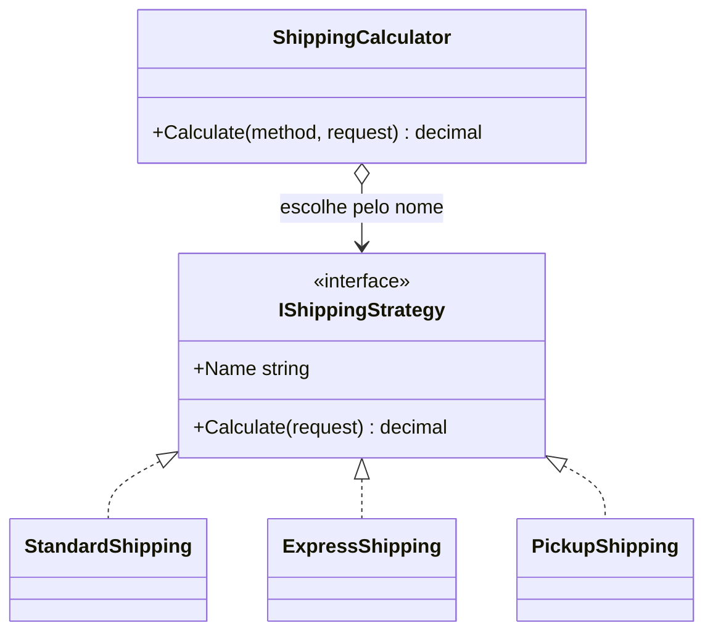

# Strategy

**Categoria:** Comportamental

## Intenção

Definir uma família de algoritmos, encapsular cada um deles e torná-los intercambiáveis. O código que usa o algoritmo (o *contexto*) escolhe qual aplicar sem conhecer os detalhes de nenhum deles.

## O problema

Um e-commerce precisa calcular o frete por método de entrega: padrão, expresso e retirada na loja. A primeira versão ([`Bad/LegacyShippingCalculator.cs`](Bad/LegacyShippingCalculator.cs)) usa um `if/else` sobre uma string:

- Cada novo método de frete obriga a **editar** a mesma classe (viola Open/Closed).
- A classe vira um depósito de regras sem relação entre si.
- Strings "mágicas" só falham em runtime.
- Não dá para testar uma regra de preço isoladamente.

## A solução

Cada regra de preço vira uma classe que implementa `IShippingStrategy`. O `ShippingCalculator` (contexto) recebe as estratégias disponíveis e delega o cálculo à escolhida.



## Arquivos

| Arquivo | Papel |
|---|---|
| [`Bad/LegacyShippingCalculator.cs`](Bad/LegacyShippingCalculator.cs) | Versão sem o padrão (`if/else`) |
| [`Good/IShippingStrategy.cs`](Good/IShippingStrategy.cs) | Interface da estratégia |
| [`Good/StandardShipping.cs`](Good/StandardShipping.cs), [`ExpressShipping.cs`](Good/ExpressShipping.cs), [`PickupShipping.cs`](Good/PickupShipping.cs) | Estratégias concretas |
| [`Good/ShippingCalculator.cs`](Good/ShippingCalculator.cs) | Contexto |
| [`Good/DelegateShippingCalculator.cs`](Good/DelegateShippingCalculator.cs) | Variante idiomática com `Func<>` |
| [`ShippingStrategyTests.cs`](../../../../tests/DesignPatterns.Tests/Behavioral/Strategy/ShippingStrategyTests.cs) | Testes xUnit |

## Quando usar

- Existem várias variações de um algoritmo e você escolhe entre elas em runtime.
- Há um `if/else` ou `switch` grande que decide *como* fazer algo (preço, desconto, ordenação, formato de exportação).
- Você quer adicionar novas variações sem mexer no código existente.
- Quer testar cada variação isoladamente.

## Quando **não** usar

- Só há duas variações e é improvável que apareçam outras: um `if` simples é mais claro.
- O algoritmo nunca muda em runtime nem precisa ser trocado: o padrão só acrescenta indireção.
- As variações diferem só por um parâmetro numérico: passe o parâmetro, não crie uma classe.

## No C# moderno

- **Delegates:** quando a estratégia é curta e sem estado, `Func<TRequest, TResult>` dispensa interface e classe (veja `DelegateShippingCalculator`).
- **Injeção de dependência:** registre cada implementação como `IShippingStrategy` e peça `IEnumerable<IShippingStrategy>` no construtor. O container injeta todas.

  ```csharp
  services.AddSingleton<IShippingStrategy, StandardShipping>();
  services.AddSingleton<IShippingStrategy, ExpressShipping>();
  services.AddSingleton<IShippingStrategy, PickupShipping>();
  services.AddSingleton<ShippingCalculator>();
  ```
- **Keyed services (.NET 8+):** `AddKeyedSingleton` permite resolver a estratégia pela chave, sem montar o dicionário à mão.

## Relacionados

- **State:** estruturalmente parecido, mas no State o próprio objeto troca de comportamento conforme seu estado; no Strategy o cliente escolhe o algoritmo.
- **Template Method:** variação por herança (passos fixos, detalhes sobrescritos). Strategy usa composição.
- **Decorator:** acrescenta comportamento em volta de um objeto; Strategy troca o comportamento.

## Referências

- [Refactoring.Guru: Strategy](https://refactoring.guru/pt-br/design-patterns/strategy)
