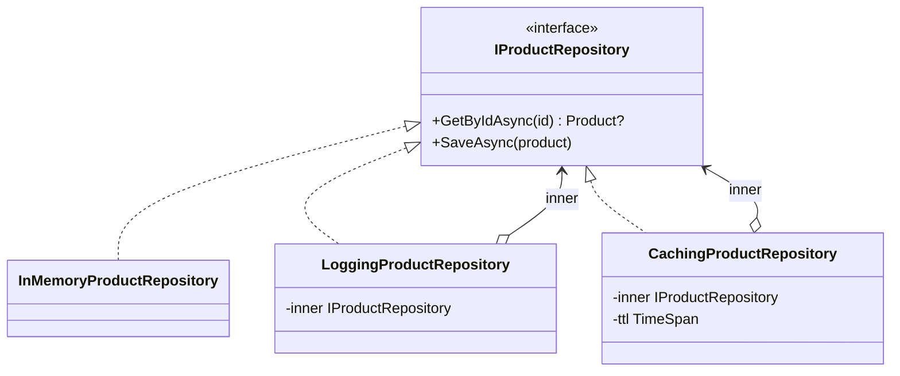

# Decorator

**Categoria:** Estrutural

## Intenção

Acrescentar responsabilidades a um objeto embrulhando-o em outro objeto com a **mesma interface**. Cada embrulho (*decorator*) faz sua parte e repassa a chamada para o objeto de dentro. Como todos têm a mesma interface, dá para empilhar quantos forem necessários sem que o cliente perceba.

## O problema

Um catálogo de produtos lê do banco por um repositório. Com o tempo, pedem log de cada consulta e, depois, cache para aliviar o banco. A primeira versão ([`Bad/ProductRepository.cs`](Bad/ProductRepository.cs)) coloca tudo na mesma classe:

- Acesso a dados, log e cache misturados em cada método (viola SRP).
- Ligar/desligar comportamento vira flag no construtor e `if` em todo método.
- Um novo comportamento (métricas, retry, autorização) obriga a **editar** a classe (viola Open/Closed).
- A ordem entre log e cache fica fixa: não dá para escolher logar só as idas ao banco.
- O repositório de pedidos ou de clientes precisa copiar e colar a mesma lógica.
- Não dá para testar o cache sem o acesso a dados.

## A solução

O cliente depende de `IProductRepository`. O repositório real só acessa dados. Log e cache viram classes separadas que **implementam** `IProductRepository` e **recebem** um `IProductRepository` no construtor:

```csharp
IProductRepository repository =
    new LoggingProductRepository(
        new CachingProductRepository(
            new InMemoryProductRepository(seed),
            ttl: TimeSpan.FromMinutes(5)),
        log: Console.WriteLine);
```



### A ordem importa

As camadas são executadas de fora para dentro:

| Montagem | O que é logado |
|---|---|
| `Logging(Caching(Banco))` | Toda chamada do cliente, inclusive as servidas pelo cache |
| `Caching(Logging(Banco))` | Só as chamadas que chegaram ao banco (cache miss) |

Na versão `Bad` essa escolha está fixa no código; com decorators, é só mudar a montagem. Os testes `Order_*` mostram as duas.

## Arquivos

| Arquivo | Papel |
|---|---|
| [`Product.cs`](Product.cs) | Modelo compartilhado por `Bad` e `Good` |
| [`Bad/ProductRepository.cs`](Bad/ProductRepository.cs) | Versão sem o padrão (classe "faz-tudo" com flags) |
| [`Good/IProductRepository.cs`](Good/IProductRepository.cs) | Componente (interface comum) |
| [`Good/InMemoryProductRepository.cs`](Good/InMemoryProductRepository.cs) | Componente concreto (só dados) |
| [`Good/LoggingProductRepository.cs`](Good/LoggingProductRepository.cs) | Decorator de log |
| [`Good/CachingProductRepository.cs`](Good/CachingProductRepository.cs) | Decorator de cache com expiração |
| [`ProductRepositoryDecoratorTests.cs`](../../../../tests/DesignPatterns.Tests/Structural/Decorator/ProductRepositoryDecoratorTests.cs) | Testes xUnit |

## Quando usar

- Preocupações transversais em volta de um serviço: log, cache, métricas, retry, autorização, validação.
- Você quer ligar/desligar ou reordenar comportamentos por configuração, sem mexer na classe original.
- A classe original é de terceiros ou não pode ser alterada, mas você controla a interface que ela implementa.
- Herança geraria uma explosão de subclasses (`CachedLoggedRepository`, `LoggedRetriedRepository`...).

## Quando **não** usar

- A interface é enorme: cada decorator precisa repassar dezenas de métodos que não lhe interessam. Prefira quebrar a interface ou usar um pipeline/middleware.
- Só existe uma combinação fixa e ela nunca muda: o ganho de flexibilidade não compensa as camadas extras.
- O comportamento depende de detalhes internos do objeto decorado (o decorator só enxerga a interface pública).
- Muitas camadas dificultam a depuração: a pilha de chamadas fica longa e a ordem vira fonte de bug.

## No C# moderno

- **A BCL é cheia de decorators:** `BufferedStream`, `GZipStream` e `CryptoStream` embrulham outro `Stream`; `DelegatingHandler` faz o mesmo com o `HttpClient` (log, retry, autenticação).
- **Injeção de dependência:** o container nativo não tem `Decorate`, mas dá para montar com uma factory:

  ```csharp
  services.AddSingleton<InMemoryProductRepository>();
  services.AddSingleton<IProductRepository>(sp =>
  {
      var logger = sp.GetRequiredService<ILogger<LoggingProductRepository>>();

      return new LoggingProductRepository(
          new CachingProductRepository(
              sp.GetRequiredService<InMemoryProductRepository>(),
              TimeSpan.FromMinutes(5)),
          message => logger.LogInformation("{Message}", message));
  });
  ```

  A biblioteca [Scrutor](https://github.com/khellang/Scrutor) simplifica para `services.Decorate<IProductRepository, CachingProductRepository>()`.
- **Log e cache prontos:** num projeto real, use `ILogger<T>` no decorator de log e `IMemoryCache` ou `HybridCache` (.NET 9+) no de cache, em vez do dicionário deste exemplo.
- **`TimeProvider` (.NET 8+):** abstrai o relógio. Os testes injetam um relógio falso para expirar o cache sem `Thread.Sleep`.
- **Middleware do ASP.NET Core e behaviors do MediatR** aplicam a mesma ideia como um pipeline de funções.

## Relacionados

- **Proxy:** mesma estrutura, intenção diferente. O Proxy controla o *acesso* ao objeto (lazy loading, permissão, remoto); o Decorator *acrescenta* comportamento.
- **Adapter:** muda a interface do objeto; o Decorator mantém a mesma.
- **Chain of Responsibility:** estrutura parecida, mas cada elo decide se trata a chamada ou passa adiante; o decorator normalmente sempre repassa (o cache só deixa de repassar quando já tem a resposta).
- **Composite:** também usa composição recursiva, mas para montar árvores com vários filhos; o decorator tem um único filho.
- **Strategy:** troca o comportamento por dentro; o Decorator acrescenta comportamento por fora.

## Referências

- [Refactoring.Guru: Decorator](https://refactoring.guru/pt-br/design-patterns/decorator)
